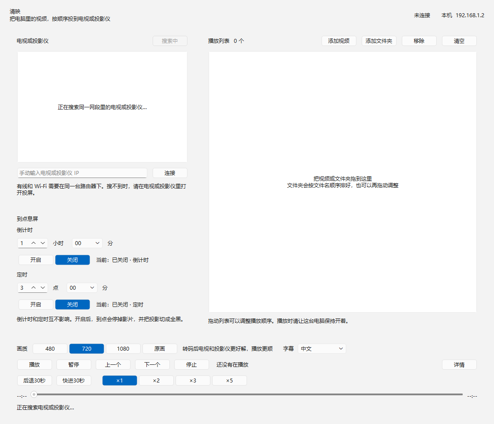

# 清映

qingying，一款免费的投屏工具。

把电脑里的视频，按顺序投到同一局域网里的电视、投影仪，以及其他支持 DLNA 的设备。播放时电脑保持开着，片子在电视或投影仪上播。

## 下载

[下载 Windows 发布版](https://github.com/chaoyiwang09/qingying/releases/latest/download/Qingying-windows.zip)

解压后双击 `清映.exe` 就能用。ffmpeg 已经封装在里面，不用另外安装。

## 界面

<p align="center">
  
</p>

## 打赏

喜欢的话，可以打赏哦。

<p align="center">
  
</p>

## 它能做什么

- 搜索同一路由器下的电视或投影仪，搜不到时可以手填 IP。
- 拖入视频或文件夹。文件夹按文件名排序，列表可以再拖动调整。
- 播放、暂停、上一个、下一个、停止，后退或快进 30 秒。
- 倍速：1、2、3、5 倍。
- 拖动进度条时，会显示附近的画面。
- 画质可选 480、720、1080 或原画。转码后多数电视和投影仪更好解。
- 自动找同目录字幕。有中英双语就优先用；否则用你选的语言，没有再试中文，再没有试英语。
- 到点息屏：倒计时和定时互不影响。到点会停掉影片，并把画面切成全黑。

支持的视频：mp4、mkv、avi、mov、wmv、flv、webm、m4v、ts、m2ts、mpg、mpeg。  
支持的字幕：srt、ass、ssa、vtt。

## 使用前

1. 电脑和电视、投影仪连到同一台路由器。有线和 Wi-Fi 也要在同一个网里，不能一个在主路由、一个在访客网络。
2. 在电视或投影仪里打开投屏（DLNA / 无线投屏）。
3. 播放期间不要让电脑睡眠。清映播放时会尽量阻止系统休眠。

程序会尝试放行本机端口 `18765–18784`，让电视或投影仪连回电脑。如果搜到了设备但一直投不出去，用管理员身份运行一次。

## 从源码运行

需要 Windows 和 Python 3.10 或更新版本。发布版不需要这一步。

```bat
py -3 -m pip install -r requirements.txt
py -3 main.py
```

也可以双击 `启动清映.bat`。如果旁边已经有打包好的 `dist\清映\清映.exe`，脚本会直接打开它。

---

# Qingying

Qingying, a free casting tool.

Cast videos from a Windows PC, in playlist order, to a TV, projector, or other DLNA device on the same LAN. The PC stays on as the remote. The movie plays on the TV or projector.

## Download

[Download the Windows release](https://github.com/chaoyiwang09/qingying/releases/latest/download/Qingying-windows.zip)

Unzip it and open `清映.exe`. ffmpeg is already packed in, so there is nothing else to install.

## Interface

<p align="center">
  
</p>

## Tips

If you like it, a tip is welcome.

<p align="center">
  
</p>

## What it does

- Finds TVs and projectors on the same router. If discovery fails, type the device IP.
- Accepts dropped videos or folders. A folder is sorted by file name, and the playlist can be reordered by dragging.
- Play, pause, previous, next, stop, and jump backward or forward 30 seconds.
- Speeds: 1×, 2×, 3×, and 5×.
- Dragging the timeline shows a nearby frame.
- Picture size: 480, 720, 1080, or original. Transcoding is easier for most TVs and projectors to decode.
- Picks up subtitle files in the same folder. A Chinese-English subtitle is preferred. Otherwise it uses the selected language, then Chinese, then English.
- Sleep timer: a countdown and a clock time work independently. At the chosen time, playback stops and the screen switches to a black frame.

Video: mp4, mkv, avi, mov, wmv, flv, webm, m4v, ts, m2ts, mpg, mpeg.  
Subtitles: srt, ass, ssa, vtt.

## Before you start

1. Put the PC and the TV or projector on the same router. Ethernet and Wi-Fi must be the same network, not a guest network beside the main LAN.
2. Turn on casting on the TV or projector (DLNA / wireless display).
3. Leave the PC awake while a video is playing. Qingying asks Windows not to sleep during playback.

Qingying tries to allow local TCP ports `18765–18784` so the TV or projector can connect back. If a device is found but playback never starts, run it once as administrator.

## Run from source

Windows, with Python 3.10 or newer. The release download does not need this.

```bat
py -3 -m pip install -r requirements.txt
py -3 main.py
```

`启动清映.bat` does the same. If `dist\清映\清映.exe` is already there, the script opens that instead.
